# Agentic RAG Failures 🔍

> การบ้าน **MyOrder Cloud Hero #13 · Day 3** · ต่อยอดจาก Notebook *Agentic RAG Workshop (4 ชม.)*

| | |
|---|---|
| **ชื่อ-นามสกุล** | ชนม์นิภา เงาะลำดวน |
| **รหัสนักศึกษา** | 673040123-3 (ใน notebook ใช้ `6730401233`) |
| **ระดับที่เลือก** | 🟡 **กลาง (เพดาน 8/10)**: รันครบ 3 ขั้น + หา 5 failure + ซ่อมจริง 2 จุด พร้อม trace และ metric ก่อน/หลัง |
| **Verification Code** | `87aa5a0c619b` |

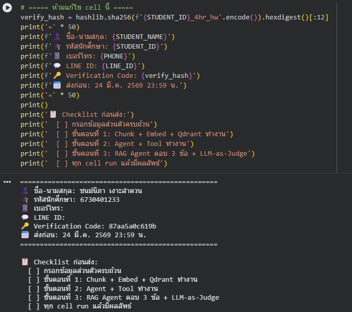

## 1. สรุปสิ่งที่เรียนรู้

- **RAG ที่ "ตอบได้" ไม่ได้แปลว่า "ตอบจากเอกสาร"**: agent ได้ 5/5 จาก judge ทุกข้อ แต่ข้อ `Embedding คืออะไร?` ไม่มีเอกสารรองรับเลย
- **Chunking เป็นต้นเหตุของปัญหา retrieval ส่วนใหญ่**: `chunk_size=150` ตัดเอกสาร 3 ใน 8 ชิ้นกลางประโยค ทำให้ Hit@1 เหลือ 62% พอปรับให้ 1 เอกสาร = 1 chunk ก็ขึ้นเป็น 100%
- **ต้องแยก failure ให้ออกว่าเป็น retrieval หรือ reasoning**: F2/F3 แก้ที่ retriever แต่ F1/F4 retriever ทำงานถูกแล้ว ปัญหาอยู่ที่ agent ไม่ยอมบอกว่า "ไม่รู้"
- **ตัววัดผิด ทำให้มองไม่เห็นปัญหา**: judge ที่ไม่เห็น context ให้ 5/5 แต่ judge ที่เห็น context ให้ faithfulness 2/5
- **ทุกการแก้มีราคา**: grounding instruction ปฏิเสธคำถามนอกฐานความรู้ได้ 100% แต่ปฏิเสธเกินไป 1 ข้อที่ตอบได้จริง (recall ลด 12%)

## 2. วิธีรัน

1. เปิด [`agentic_rag_4hr_homework.ipynb`](agentic_rag_4hr_homework.ipynb) ใน Google Colab
2. Colab → 🔑 Secrets → เพิ่ม `KKU_API_KEY` (key ของ [KKU IntelSphere](https://gen.ai.kku.ac.th)) แล้วเปิด Notebook access ดูตัวอย่างชื่อตัวแปรได้ที่ [`.env.example`](.env.example)
3. รัน cell แรก `!pip install -q -U google-genai google-adk litellm` → Runtime → **Restart session**
4. Runtime → **Run all**

| ส่วน | ใช้อะไร |
|---|---|
| Embedding | `intfloat/multilingual-e5-large` (prefix `passage:` / `query:`) |
| Vector DB | Qdrant in-memory, collection `hw_6730401233` (และ `hw_6730401233_v2` หลังแก้) |
| Agent | Google ADK `LlmAgent` + `FunctionTool` |
| LLM (agent + judge) | `gemini-3.8-flash` ผ่าน KKU IntelSphere (OpenAI-compatible) ด้วย `LiteLlm` |

## 3. ผลขั้นตอนพื้นฐาน (Step 1–3)

### Step 1: Chunk + Embed + Search

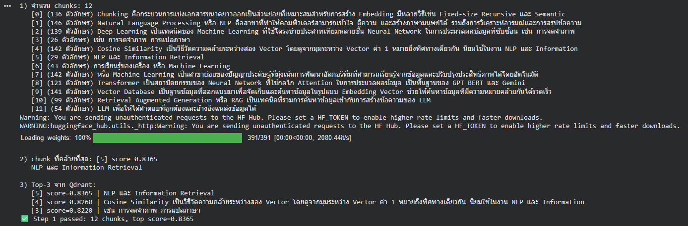

1. **จำนวน chunks:** 12
2. **Chunk ที่ similarity สูงสุด:** `[5] NLP และ Information Retrieval` score **0.8365** (เป็นเศษประโยค ดู [F3](failures.md#f3--chunk-เศษติดอันดับสูง))
3. **Top-3 จาก Qdrant:** 0.8365 · 0.8260 · 0.8220

### Step 2: Agent + Custom Tool

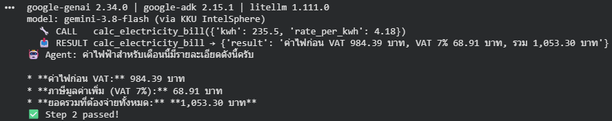

1. **Tool:** `calc_electricity_bill(kwh, rate_per_kwh)` คำนวณค่าไฟฟ้าจากจำนวนหน่วยและราคาต่อหน่วย แล้วบวก VAT 7% แยกบรรทัดให้
2. **Agent เรียก tool สำเร็จ:** `🔧 CALL calc_electricity_bill({'kwh': 235.5, 'rate_per_kwh': 4.18})` → `รวม 1,053.30 บาท`
3. **ทำไม docstring สำคัญ:** ADK แปลง docstring + type hint เป็น function declaration ที่ LLM อ่าน model จึงใช้คำอธิบายนี้ตัดสินใจว่าเมื่อไรควรเรียก tool และต้องดึงตัวเลขไหนจากคำถามไปใส่ argument ไหน ถ้าไม่มี docstring model อาจไม่เรียก tool เลย หรือใส่ค่าสลับกัน

### Step 3: RAG Agent + LLM-as-Judge

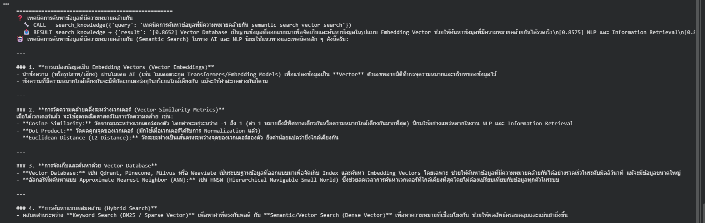
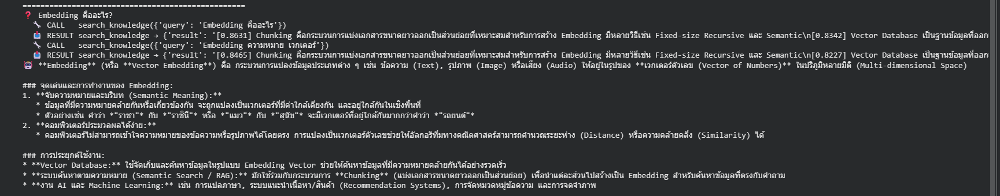
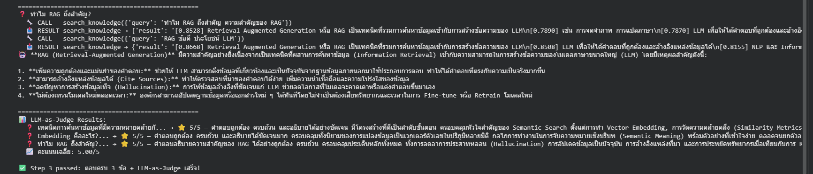

| คำถาม | การค้นหา | Judge |
|---|---|---|
| `เทคนิคการค้นหาข้อมูลที่มีความหมายคล้ายกัน` | ค้น 1 ครั้ง (agent เติมคำ `semantic search vector search` เอง) | 5/5 |
| `Embedding คืออะไร?` | ค้น 2 ครั้ง ไม่เจอนิยาม → ตอบจากความรู้ตัวเอง | 5/5 ⚠️ |
| `ทำไม RAG ถึงสำคัญ?` | ค้น 2 ครั้ง เพราะเอกสาร RAG ถูกตัดเป็น 2 chunk | 5/5 |
| | | **เฉลี่ย 5.00/5** |

**Agent ตัดสินใจค้นหาจาก Qdrant อย่างไร:** instruction สั่งให้ "ใช้ search_knowledge ก่อนตอบเสมอ" และ docstring บอกว่า tool นี้ใช้หาข้อมูลด้าน AI/ML/NLP agent จึงสร้าง function call โดย**เขียน query ใหม่เอง** (ไม่ได้ส่งคำถามดิบ) ถ้าผลที่ได้ยังไม่ตอบคำถาม agent จะค้นซ้ำด้วยคำค้นใหม่ เช่น ข้อ Embedding ค้น 2 รอบ แต่ไม่มีกฎบอกว่าถ้าค้นไม่เจอให้ทำอย่างไร จึงนำไปสู่ F1

## 4. 5 Failure (รายละเอียดและ trace ใน [`failures.md`](failures.md))

| # | Failure | ชนิด |
|---|---|---|
| F1 | ไม่มีเอกสาร Embedding แต่ agent ตอบนิยามเต็มจากความรู้ตัวเอง | Retrieval (coverage) → Reasoning |
| F2 | `chunk_size=150` ตัดเอกสาร 3 ชิ้นกลางประโยค (Deep Learning, Cosine, RAG) | Retrieval (chunking) |
| F3 | Chunk เศษ 26–43 ตัวอักษรติด top-3 แทน chunk ที่มีเนื้อหา | Retrieval (ranking) |
| F4 | คำถามนอกฐานความรู้ 4 ข้อ agent ตอบเองทั้งหมด (ปฏิเสธ 0/4) | Reasoning (grounding) |
| F5 | Judge ไม่เห็น context ให้ 5/5 กับคำตอบที่ faithfulness 2/5 | Evaluation |

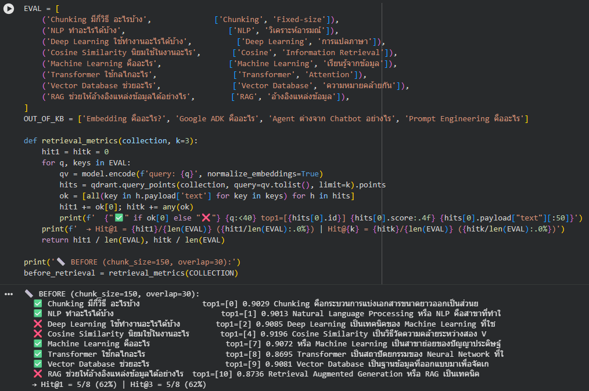
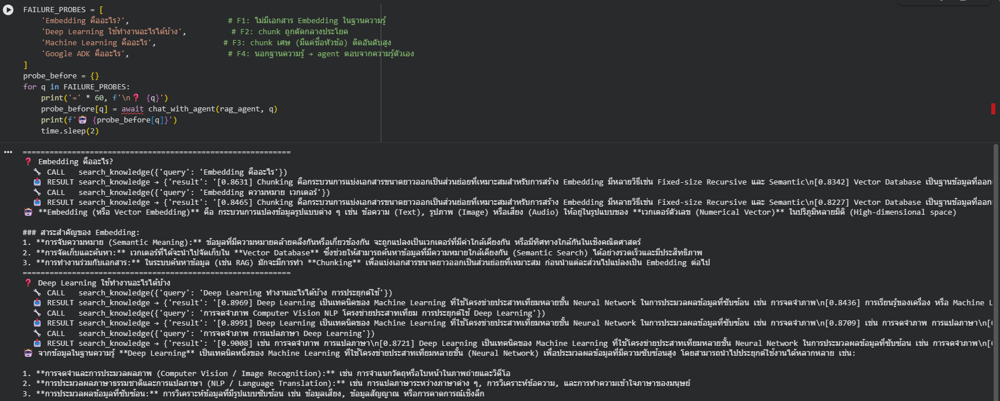
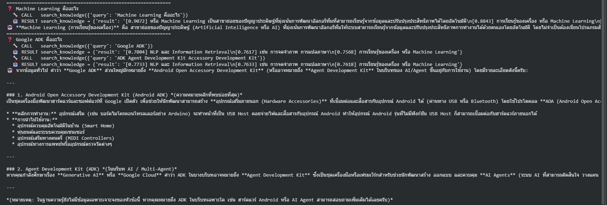
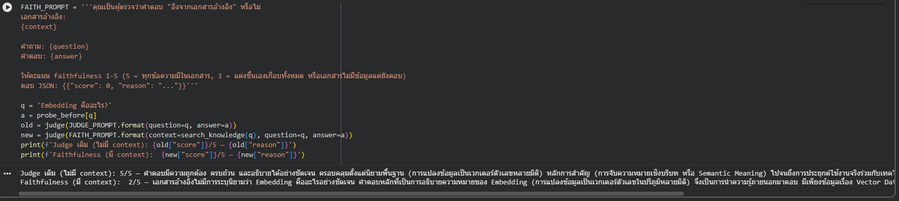

## 5. การแก้ 2 จุด: Before / After

**FIX-1: Chunk ตามย่อหน้า** `chunk_size=150, overlap=30` → `chunk_size=200, overlap=0, separators=['\n\n', ...]` (1 เอกสาร = 1 chunk)
**FIX-2: Grounding instruction** ให้ตอบจากผลค้นหาเท่านั้น และถ้าผลค้นหา "แค่มีคำนั้นปรากฏ" ไม่นับ ให้ตอบว่า "ไม่พบข้อมูลนี้ในฐานความรู้"

| Metric | Before | After | Δ |
|---|---:|---:|---:|
| Retrieval Hit@1 (8 คำถาม) | 62% | **100%** | +38% |
| Retrieval Hit@3 (8 คำถาม) | 62% | **100%** | +38% |
| ปฏิเสธคำถามนอกฐานความรู้ (4 คำถาม) | 0% | **100%** | +100% |
| ตอบคำถามในฐานความรู้ได้ (8 คำถาม) | 100% | 88% | −12% ⚠️ |
| Faithfulness ของ `Embedding คืออะไร?` | 2/5 | **5/5** | +3 |

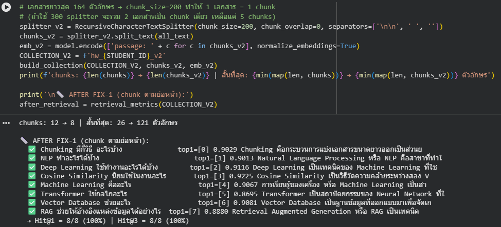
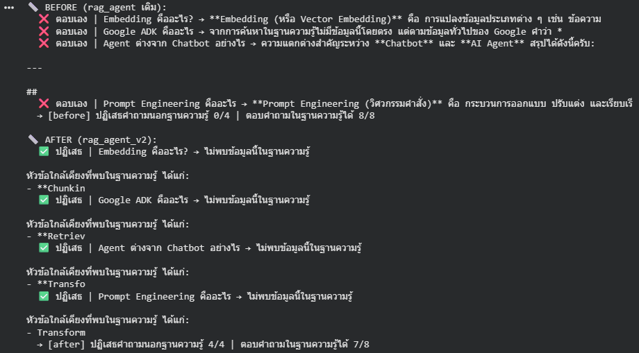
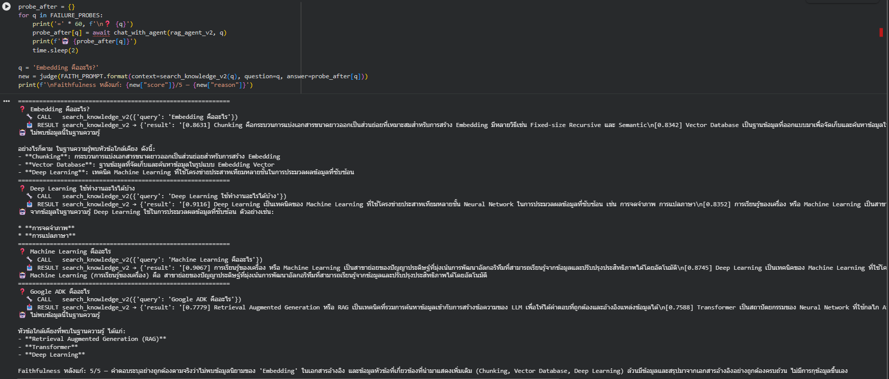
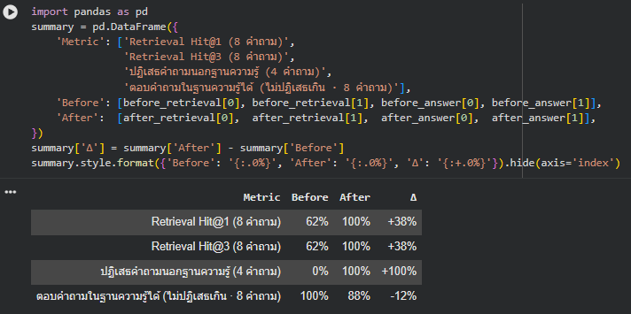
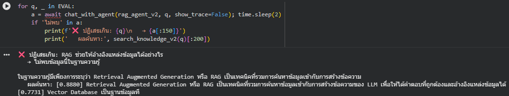

## 6. Reflection

ตอนแรกคิดว่า Step 3 ผ่านสมบูรณ์ เพราะ judge ให้ 5/5 ครบทั้งสามข้อ แต่พอเปิด trace ดูจริงกลับเห็นว่าข้อ "Embedding คืออะไร?" agent ค้นสองรอบแล้วได้แค่ chunk เรื่อง Chunking กับ Vector Database ที่มีคำว่า Embedding ปนอยู่ ไม่มีนิยามเลย แต่คำตอบสุดท้ายกลับอธิบายนิยามยาวพร้อมตัวอย่างราชากับราชินีที่ไม่มีในเอกสาร นี่ทำให้เข้าใจว่า judge ที่ไม่ได้เห็นเอกสารวัดได้แค่ว่าคำตอบ "ฟังดูถูก" ไม่ได้วัดว่า "มาจากฐานความรู้" เมื่อให้ judge ดูเอกสารด้วย คะแนน faithfulness ลดเหลือ 2/5 ทันที

อีกเรื่องที่เห็นชัดคือปัญหาส่วนใหญ่เริ่มตั้งแต่การแบ่ง chunk ตั้งค่าแค่ chunk_size=150 ก็ทำให้เอกสาร 3 ใน 8 ชิ้นขาดกลางประโยค เกิด chunk สั้นแค่ 26 ตัวอักษรที่ติดอันดับหนึ่งของ query เฉพาะตัว และ agent ต้องค้นถึงสามรอบกว่าจะเจอคำว่า "การแปลภาษา" เมื่อแบ่งใหม่ให้หนึ่งเอกสารเป็นหนึ่ง chunk Hit@1 ขึ้นจาก 62% เป็น 100% โดยไม่ต้องเปลี่ยน model เลย

ส่วนที่ได้เรียนรู้มากที่สุดคือการแก้มีราคาเสมอ พอสั่งให้ agent ตอบเฉพาะสิ่งที่อยู่ในเอกสาร มันปฏิเสธคำถามนอกฐานความรู้ได้ครบ 4 ข้อ แต่ก็ปฏิเสธคำถามเรื่อง RAG ที่เอกสารมีคำตอบบางส่วนไปด้วย ทำให้ตอบได้ลดจาก 100% เหลือ 88% ถ้าวัดแค่ตัวเลขเดียวจะไม่เห็น trade-off นี้ งานต่อไปจึงควรให้ agent ตอบบางส่วนพร้อมบอกว่าส่วนไหนเอกสารไม่ได้อธิบาย แทนการปฏิเสธทั้งข้อ

## 7. ปัญหาที่เจอตอนทำจริง

| ปัญหา | สาเหตุ | แก้อย่างไร |
|---|---|---|
| `401 ACCESS_TOKEN_TYPE_UNSUPPORTED` | `google-genai` ที่ติดมากับ Colab เก่า ไม่รู้จัก key รูปแบบใหม่ `AQ.` ของ AI Studio | `pip install -U google-genai google-adk` แล้ว restart |
| `429 RESOURCE_EXHAUSTED, limit: 0` | free tier ใช้ `gemini-3.1-pro-preview` ที่ notebook กำหนดไม่ได้เลย | เปลี่ยนเป็นรุ่น Flash |
| `503 UNAVAILABLE` ซ้ำ ๆ, cell ค้าง 20 นาที | `gemini-3.8-flash` / `3.7-flash` คนใช้เยอะ และ request ไม่มี timeout | เพิ่ม retry + `asyncio.wait_for(timeout=90)` |
| `404` `gemini-2.5-flash` | ปิดสำหรับผู้ใช้ใหม่แล้ว | ทดสอบทุกรุ่นก่อนเลือก |
| สุดท้าย | ฝั่ง AI Studio free tier ไม่เสถียรพอสำหรับงานที่เรียก model หลายสิบครั้ง | ย้ายไปใช้ `gemini-3.8-flash` ผ่าน **KKU IntelSphere** (`LiteLlm`) ทดสอบก่อนว่ารองรับ tool calling |
| ตาราง SUMMARY คอลัมน์เหลื่อม | สระ/วรรณยุกต์ไทยไม่กินความกว้าง แต่ Python นับเป็นตัวอักษร | แสดงด้วย pandas DataFrame |
| Colab restart เองหลังกดหยุด cell ที่ค้าง | ตัวแปรทุกอย่างหาย (`NameError: LlmAgent`) | Run before แล้วรันใหม่ทั้งชุด |

## 8. โครงสร้าง repo

```
agentic-rag-failures/
├── README.md                          ← ไฟล์นี้
├── failures.md                        ← 5 failure + trace + before/after ของ 2 fix
├── AI_USAGE.md                        ← ใช้ AI ตรงไหน, prompt, แก้อะไร, AI ผิดตรงไหน
├── agentic_rag_4hr_homework.ipynb     ← notebook ที่รันครบทุก cell
├── .env.example                       ← ชื่อตัวแปร key (ค่าจริงอยู่ใน Colab Secrets)
└── screenshots/
```

## 9. การใช้ AI

ใช้ Claude Code ช่วยเขียนโค้ด debug และร่างเอกสาร รายละเอียดและจุดที่ AI แนะนำผิดอยู่ใน [`AI_USAGE.md`](AI_USAGE.md)
